*This article is a summary of my 2026 BeerRump presentation in Paris.*

Introduction
============

Hardware attacks that were deemed lab-grade in the middle of the 2010s are now in my opinion basic attacks that everyone should be able to perform even with a constrained budget. My whole point is that the attacker's bar has been *dramatically* lowered, which means it's up to defenders to evenly raise theirs.

This stems from two combining trends:

* availability of tooling, mostly driven by Colin O'Flynn
* positive feedback loop of researcher documentation which leads to generalization and refinement of attacks

Enter the FaultyCat
===================

A few months back I came across a Reddit post in which a user asked about a FaultyCat clone he found on AliExpress. The FaultyCat is itself a clone of the open-source PicoEMP, which I own and have been using with great success on all manner of MCUs (and even SoCs!). The trouble everyone encounters when trying to get a PicoEMP is that they're always out of stock. It's also difficult to build one yourself because finding all the components in one place is a hassle, some are hard to source and some have been superseded by now. This costs money and more importantly wastes a lot of time. So at 30 euros it's a no-brainer and I got one just to try it.

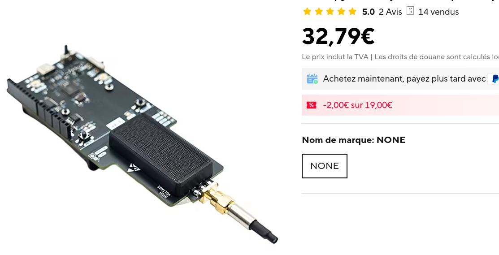

Upon receiving it a week later I visually compared the power rails. As expected, they're essentially the same:
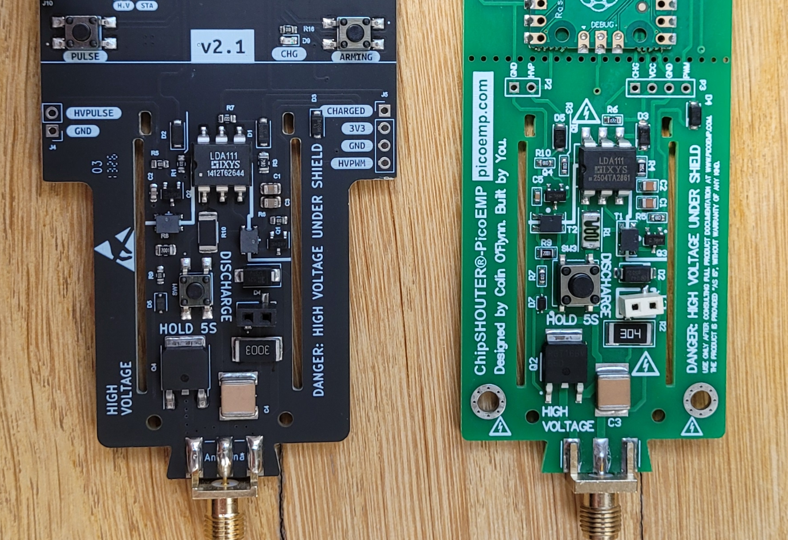

Before using it efficiently, a few things had to be addressed first.

Ditch the probe and make your own
---------------------------------

The EM injection probe that comes with this version of the FaultyCat I found to be empirically bad with a dramatically low injection success with all other parameters fixed. This could be due to the target but I've also tested several MCUs from different semiconductor companies and it performed badly.

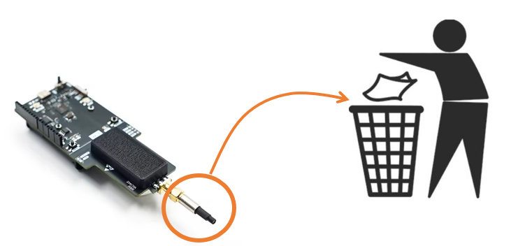

I think there are two problems with this probe:

* the ferrite core extends too much from the coil and it isn't shaped. You could either lap it completely or shape it into a cone but even then it performs suboptimally
* the coil has too many turns

This is the perfect excuse to build your own injection tips!

Making your own EM injection tips
---------------------------------

These are the parameters that define a coil:

* geometry, could be a half toroid or, more commonly, a simple cylinder
* core material, usually ferrite
* core diameter, usually 0.75mm to 5mm for MCUs (lower when moving on to SoCs)
* clockwise (CW) vs counter-clockwise (CCW) winding which reverses the polarity of the pulse
* number of turns, 4-11 is pretty standard

To keep it simple start with 744710603 or 744710203 Würth chokes and expand from here. Remove as many turns as needed, solder both ends to a male SMA connector in either CW (usually preferred but try both!) or CCW and remove the excess ferrite using clippers and a file:

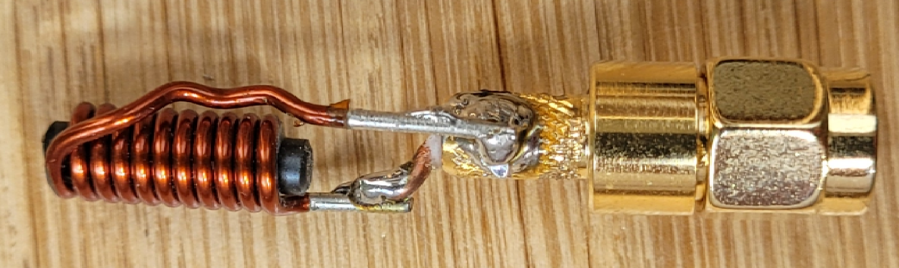

This is the first coil (3mm ferrite core, CW, 11 turns) I made, it arguably has too many turns but I have great success with it and it's my default coil for most EM injection setups.

Ditch the firmware
------------------

This is a problem I also had with the original PicoEMP: the firmware has a permanent UART listening thread to configure its properties and state. This means you need to send a UART command to re-arm it after each EM shot. And at some point (less than an hour) this thread crashes and the whole setup must be power-cycled. This is in my opinion a bad design, I'd rather have the tool be externally triggered and do nothing but fire when it gets a trigger signal.

I've pushed a release of the compiled firmware and of the code in a [repo here](https://github.com/gquere/faultycat/tree/no_uart).

A word of warning: with this version the FaultyCat is **permanently** armed. This means you should never handle it with your hands and always wait a few seconds after powering it off before handling it. **Don't be a retard here, there's a chance you might die.** If you are easily distracted maybe EMFI isn't the best technique for you.

EMFI 101
========

Why do EMFI when you could do a simple voltage fault injection?
---------------------------------------------------------------

Voltage fault injection is simple because you only need to control 2 parameters:

* injection timing T
* injection length D, which is coupled to the MCU operating frequency

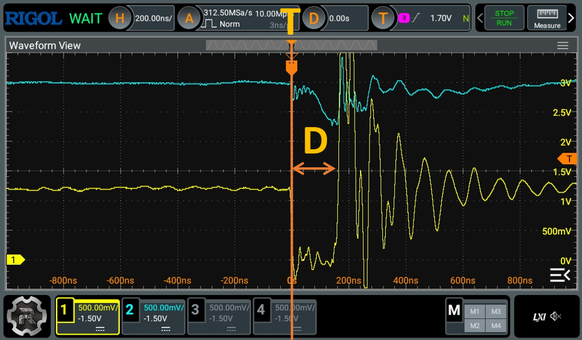

But the problem with VFI is that all of the capacitors on the board (including but not limited to the decoupling capacitors) are working against your glitch. You could either:

* remove all capacitors on the target board, which may number in the hundreds and will probably render the board unusable in non-lab conditions
* remove the MCU and place it in a socket in a makeshift minimal setup (which is what I now do)

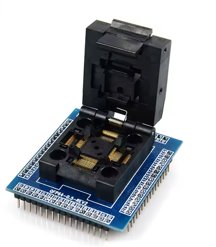

Both these solutions have the potential to be destructive.

Another issue with VFI is that some MCUs really hate being glitched this way, for instance I've played with a few Atmel MCUs that simply died after a few hundred injections.

Lastly VFI has a global effect on the chip power rails. In some cases this works fine but in some other cases spatialization (e.g. targeting a specific power rail or a specific portion of the die) is an important part of the glitch.

VFI can be highly effective when applicable but it's very intrusive. This is why more and more people are migrating towards EMFI. That being said I strongly recommend you master VFI before moving on to EMFI because it's a more challenging technique and you will need strong fundamentals to further build upon.

EMFI parameters
---------------

There are a number of parameters that EMFI adds but we'll keep things simple at first:

* coil characteristics: some coils will work well on a MCU and will have little to no effect on others, which is why you should possess a few substantially different coils on hand
* X and Y position of the EM injection tip: we'll vary this and produce an injection heatmap
* Z position of the EM injection tip: usually 0.1mm (touch the chip then go up one step)
* injection voltage: simply use the max available voltage since it's not much to begin with

When using a powerful injection setup, Z and the injection voltage are coupled and iterated upon depending on whether a glitch or a reset was obtained at a certain spot. The PicoEMP/FaultyCat is not exactly concerned by this because of how weak it is. This means only X and Y need to be varied to characterize a chip.

Varying X and Y
---------------

If you have an old 3D printer, now is the time to put it to good use:
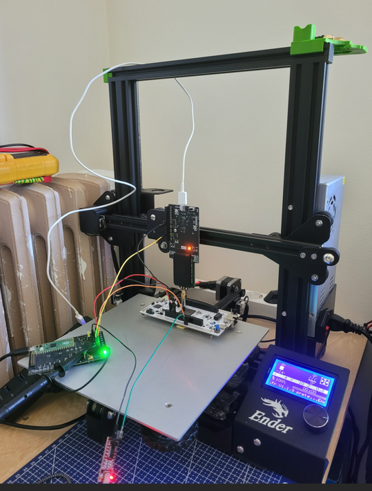

A popular alternative is to use a CNC such as the 3018:
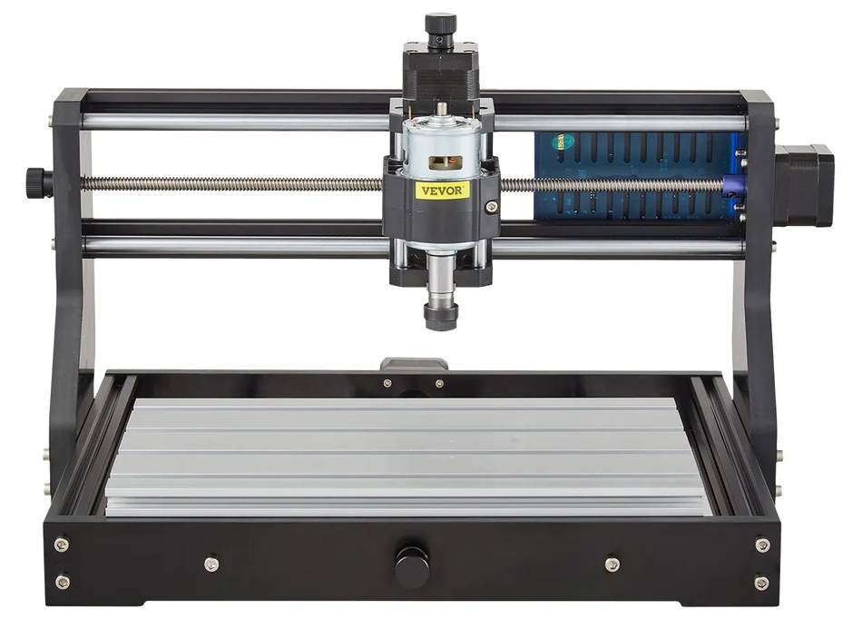

Both have two main characteristics: precision and repeatability. For MCUs a precision of 0.1mm is good enough and these two will achieve this pretty easily. Repeatability is the characteristic of coming back to the origin point and it's actually pretty important to build coherent heatmaps. Both are good enough for what we're doing here, but the CNC might suffer from more backlash whereas the belt system of the 3D printer might actually make it better. Anyway, go for the cheapest available.

Effects of varying X and Y on the fault model
---------------------------------------------

These are three successful EM faults at three different spots on the same chip (it's not actually a STM32 ;)):

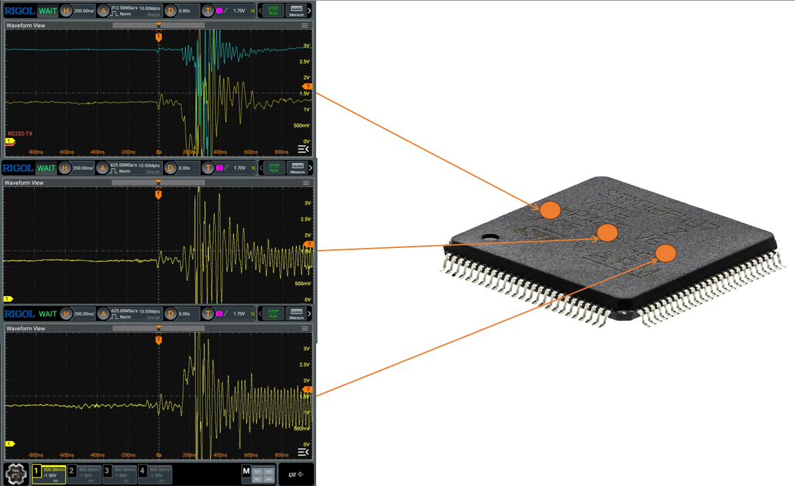

As you can see the top waveform looks incredibly similar to a voltage glitch: a negative voltage was induced in one of the power rails and that produced a successful fault. On the opposite side (maybe because of a copper loop?) the effect is reversed and a positive voltage was induced. And right in the middle (probably on the die), no current was induced on the power rail but a successful fault was achieved anyways. This suggests that we've hit at least two different fault models.

Characterization of a new target
================================

Whether you're doing VFI, EMFI or any other more advanced technique it is paramount to start with an unhardened whitebox target so that its behaviour can be fully understood before moving on to a hardened blackbox.

This part will be covered in a future post on a previously undocumented target. In the meantime, here's the method:

* build a test firmware with a specific action to glitch (e.g. flash read, function return check ...)
* toggle a GPIO right before performing this action so that a precise trigger is provided
* iterate upon (X,Y) and T, producing injection heatmaps
* refine parameters
* optionally move on to a hardened whitebox
* move on to a hardened blackbox

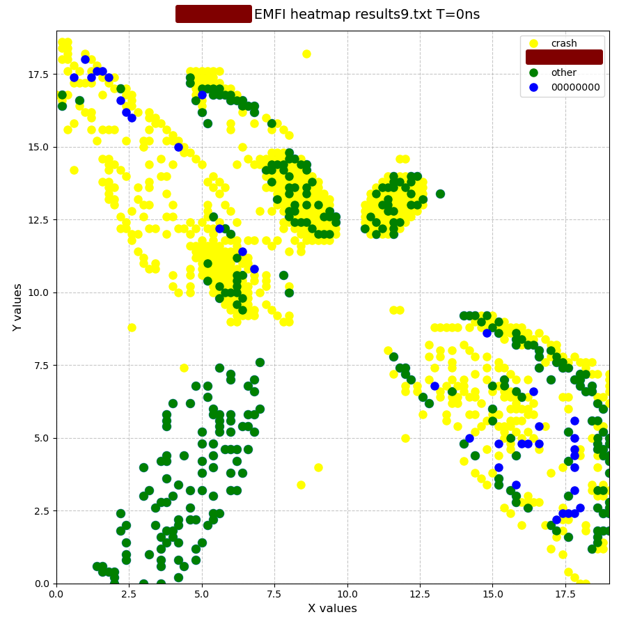

Limits of the PicoEMP/FaultyCat
===============================

When compared to other hardware the PicoEMP design really is a toy so don't expect too much from it. It has fundamental limits:

* injection capped at ~250V: this is really low and some targets (beyond MCUs) will be unglitchable at such low levels
* 1 injection per second (hard limit because of the cap recharge): probably the biggest drawback. Firstly this prevents multi-glitching and also will make attacking a chip dramatically slow; you want hundreds of injections per second, not one
* bad injection profile: I can't get into this topic now but it is central to EMFI and arguably the single most important parameter, also known as rise-time and di/dt

Alternatives
============

Supercharging the PicoEMP
-------------------------

[Incredible talk](https://www.youtube.com/watch?v=-WiIupSWss4) by RECESSIM at hardwear.io. He essentially fixed the rise time, voltage limit AND recharge time by supplying his own power source to the PicoEMP. But it's not an out-of-the-box option and is a whole project of its own that not everybody can tackle.

SiliconToaster
---------------

This is a [project by Ledger](https://github.com/Ledger-Donjon/silicon-toaster) that has several very interesting features such as dual inverted connectors so you don't have to double all your coils. It's extra powerful and to some extent can multi-glitch. However it provides no galvanic isolation between the power stage and the control, personally I won't use it for this reason and find it very dangerous both to humans and to the electronics bench built around it.

ChipShouter by NewAE
--------------------

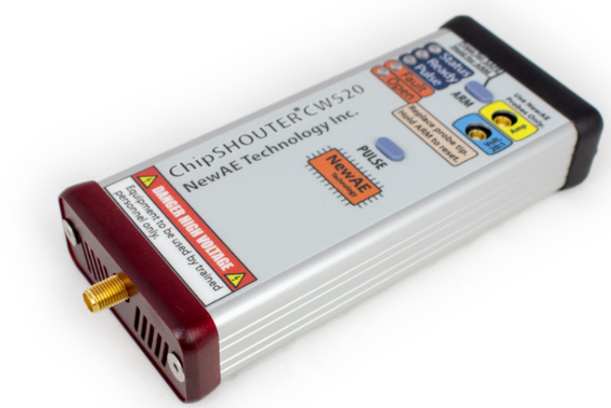

The [NewAE ChipShouter](https://www.newae.com/chipshouter) comes with a hefty price tag of $5000 but is the basis for most EMFI research nowadays. Unfortunately it's priced beyond the reach of most hobbyists and independent researchers. I wish I had one of these! (or that someone built a clone)

Keysight/Riscure
----------------

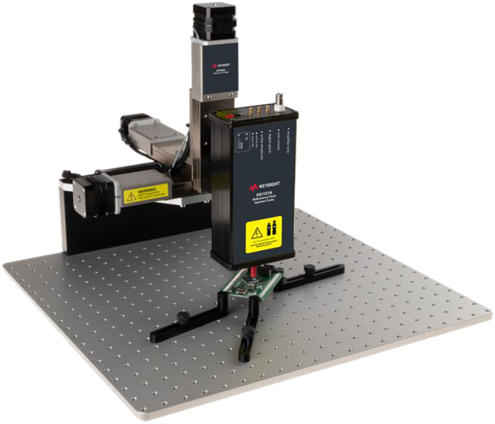

Dream on, this setup starts at $100k. It's a top-of-the-line, lab-grade equipment used by labs to test chips against advanced attacks, such as required by the [SESIP](https://trustcb.com/iot/sesip/sesip-certificates/) and [PSA](https://products.psacertified.org/) certifications.

I managed to pull a few prices from their website:

* DS1120A Unidirectional Fault Injection Probe: $43k
* DS1202A Bidirectional Fault Injection Probe: $57k
* DS1010A Precision XYZ Stage: $32k
* DS1203A High Precision Electromagnetic Probe: unknown

Conclusion
==========

EMFI takes a lot of experimenting to get into but is in my opinion nowadays a mandatory technique to apply on hardware audits. I hope this article convinced you to give it a try!
