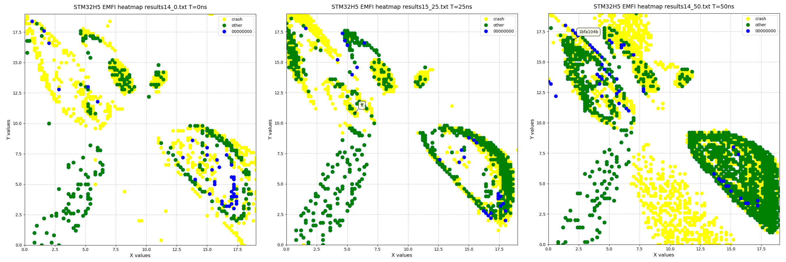
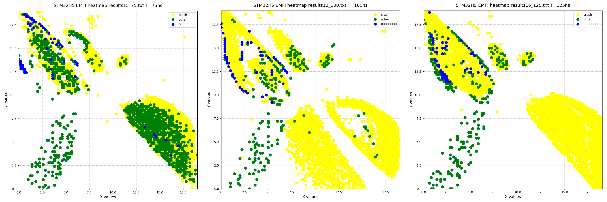
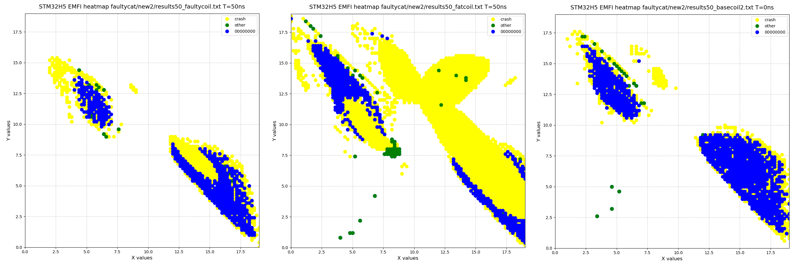
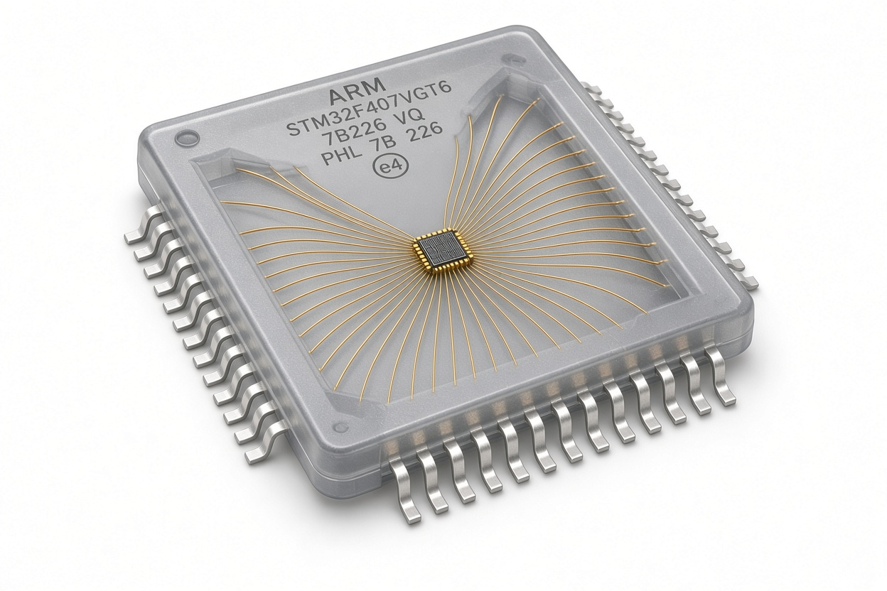

This is part 2 of a multipart series on Electromagnetic Fault Injection. Part 1 [covered the lab setup](https://www.errno.fr/EMFI_basics.html).

Characterization is an essential step to understand how a target behaves and how it can be glitched optimally. It's incredibly hard to attack blackbox systems because refining parameters blindly requires making a lot of assumptions on what, when and how to glitch.

The first step should always be to start with a whitebox system because this will enable the attacker to understand exactly what to glitch (for instance a flash read), when to glitch (by providing a signal) and how to glitch (that is, actually refining the fault parameters).

Most characterizations will be performed on a devboard. I chose the NUCLEO-H563ZI which hosts the new STM32H5 MCU which is a successor to the extremely popular STM32F series that was plagued by the infamous RDP downgrade attacks. The whole RDP mechanism has been done away with and replaced by the product lifecycle. Some other very interesting hardening options have also been introduced. It's interesting to look at the STM32H5 because to my knowledge nobody has documented fault injections against this chip family.

Building a test firmware
------------------------

The objective here is to glitch an internal flash read. The code could just as well be adapted to glitch a function return (which is anyway mostly the same thing since we're ultimately changing a register here). Or it could also be adapted to study exactly what happens at the register level. But things are kept barebones for now.

A GPIO is toggled right before the flash read: this will provide the trigger signal to the FaultyCat/PicoEMP. A negative/positive delay can also be introduced to vary the precise injection timing T.

```c
HAL_Delay(1000);
BSP_LED_Toggle(LED_GREEN);

HAL_GPIO_WritePin(GPIOD, GPIO_PIN_4, 1);              // trigger on this signal
// add dummy instructions here if you want a negative delay
volatile int flash_data = *(uint32_t *)0x08020000 ;   // read data in empty flash (FF FF FF FF)
HAL_GPIO_WritePin(GPIOD, GPIO_PIN_4, 0);

if (flash_data != 0xFFFFFFFF) {
    // getting here means the target has been glitched
    HAL_UART_Transmit(&huart2, (const uint8_t*)&flash_data, 4, 1);
    BSP_LED_On(LED_RED);
} else {
    HAL_UART_Transmit(&huart2, "aaaa", 4, 1);
}
```

The delay can be handled in a number of ways, either by adding dummy instructions before or after the toggling, by setting a delay on the FaultCat itself or by using a synchronization card in between. Make do with what you have handy!

On a real-world blackbox target things wouldn't be that easy and a huge part of attacking uncontrolled firmware is figuring out when to glitch because it's unlikely that the target itself will generate an easy to pick-up signal to synchronize with the glitch (but some do!). This will be studied in the next part discussing advanced synchronizations techniques such as power and EM tracing.

Setting parameters
------------------

First make sure that the target sits perfectly level. It's not enough that the bed is level because the package itself may not sit perfectly flat. This is crucial because otherwise it will effectively change Z at every position. Levelness can be verified by very lightly touching the chip and programmatically moving the ferrite head (it's enough to leave a mark) on the periphery and diagonals. If a square and cross appears on the epoxy then the target is level.

Z is fixed and set closest to the chip. Turn on the 3D printer or CNC (because there is always some tiny amount of movement on all axes when powering on the steppers), touch the chip (don't worry, the coil can absorb a minuscule deformation) and then add +0.1mm. From now on there is no need to vary Z.

On a commercial injector the injection power and Z parameter are coupled, that is you either back off the power or Z when getting a crash. But the PicoEMP is so weak that there's no need to do this: full power and closest to the target is enough, these parameters are considered set.

In terms of coils you have to start somewhere. So pick a coil and stick with it for a little while at least. If it gives bad results after a full day then it might be time to try another coil, but don't jump between coils too fast. This is the most interesting parameter to vary, do not be afraid to experiment but make sure to extract complete data first, you can get very surprising results!

Varying parameters to create heatmaps
-------------------------------------

The parameters (X,Y) and T are iterated upon in 25ns steps. Because the FaultyCat/PicoEMP takes a full second to recharge, a single (X, Y) scan can take several hours depending on the resolution. When also varying T this means this step takes tens of hours.

Do not forget to include all the parameters set for the run in the generated data (coil, T, Z, commit version of the coordinator script...), otherwise in a few days this data will become meaningless.

For initial mapping I use a 0.2mm step. A larger step and you risk missing injection spots, a smaller step and the scan takes way too long. Each of the scans below already takes about an hour to complete.

Each single-shot run produces an injection heatmap of the LQFP144 STM32H563, viewed from the top, pin 1 is bottom right:



The points fall into in different categories:

* No data means the target behaved as expected
* Yellow means the target crashed and didn't have a chance to answer anything
* Green means the flash value read is not what was expected, this is a successful glitch
* Blue is another instance of a successful glitch, but even more interesting because the flash read was the value 0

Varying the injection timing has a huge impact on the reliability of the injection. Also it's very interesting to see injection-susceptible zones appear and disappear by varying the injection delay.

The blue injection spots might be used to bypass a security test because they've transformed a 0xFFFFFFFF flash read into 0x00000000. Remember that in the end it's a register that contains that 0 value, and 0 is usually the return value of a success.

Comparing coils
---------------
Three different CCW coils are used here, from left to right:

* the coil that came with the FaultyCat, with excess ferrite removed, 2mm and way too many turns
* a 5mm coil, 9 turns, good for spamming
* a 3mm coil with 10 turns (best results)



See how different the results are?

Interpreting the results
------------------------

The SMT32H5 is very susceptible to glitching, you can almost guarantee a flash read corruption when placed appropriately.

But do notice how there's a blank square in all these heatmaps? That's actually the chip's die being completely unaffected by my coils!



Also see how all the faults are lining up? It's very likely that all faults were produced by hitting bond wires and actually generated something akin to a voltage glitch.

To glitch the die itself and maybe hit a different fault model we would probably need a smaller probe than what was tested here or more injection power. But heh, it works!


Target reset vs power toggling
------------------------------

This is seldom mentioned but resetting a target is not exactly the same as performing a full power cycle, [here's an example](https://wiki.recessim.com/view/ATSAM4C32#Reset_vs_Power_Cycle) of a behaviour that only appears on power cycling. On top of potentially following different code paths as pictured there could also be residual charge effects affecting internal states.

Because the PicoEMP is so slow to recharge its capacitor, it doesn't matter if some time is spent power cycling the target between each shot. It's also a better guarantee that the target will always start with a repeatable behaviour.

What's a good success rate?
---------------------------

It really depends on the target. I've had success rates as low as 1% after tuning for days and as high as basically guaranteed.

Generally and removing outliers, in my experience a good success rate is 3-5% after tuning coil, X, Y and T.

Moving on from here
-------------------

This characterization only establishes that the STM32H5 is *susceptible* to fault injection and provides refined the parameters of the injection. But that doesn't mean it's necessarily *exploitable*.

The next step depends on your goal:

* if you want to extract the firmware then you have to find a flaw in either the ROM bootloader or SBSFU that if faulted somehow bypasses the firmware protection (nobody has done this yet publicly)
* if you want to bypass a security test outside of the bootloader, that is in the application itself, then you now have everything to get started!
